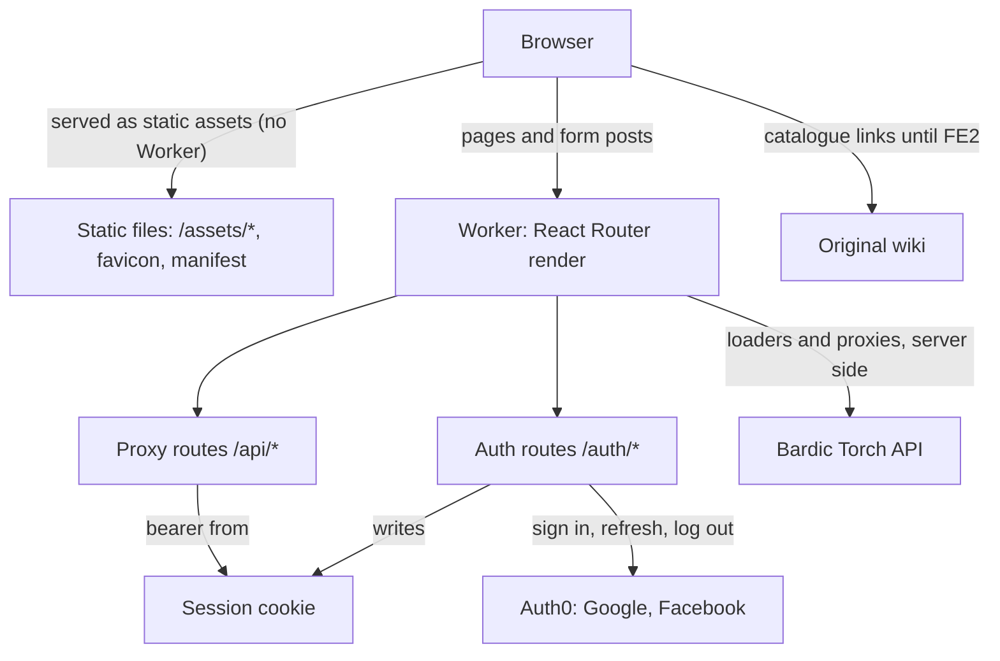

# Bardic Torch (frontend)

Bardic Torch is a community index of SCA bardic songs, stories and poems, and of the bards who made them, so they can be found, sung and passed on. It is an index, not an archive: every piece points to where its lyrics, recordings or video already live. **Links only, never lyrics.** It replaces the original wiki at https://bardictorch.miraheze.org, whose prose stays CC BY-SA 4.0.

This repository is the web frontend at https://bardictorch.org. It is a React Router 8 app in framework mode (React 19, Vite 8, Tailwind 4, TypeScript 6) on Cloudflare Workers, with the static files served as Workers static assets. The API lives in a separate backend repository and is served at https://api.bardictorch.org.

This is milestone FE1, the foundation:

- the wiki-style layout, with a header, sidebar, mobile bottom app bar and footer;
- the design system, in light and dark;
- Auth0 sign-in with Google or Facebook;
- the settings page, for your display name and API tokens;
- the static help pages and the home page.

Catalogue pages come in FE2. Until then, Browse, the facets and search link to the original wiki.

## Key concepts

- **Contract-first API.** `api/openapi.yaml` is the backend's OpenAPI 3.1 spec, vendored byte for byte with `npm run sync:api -- <path|url>`. Nobody edits it here.
  - `app/api/schema.gen.ts` is generated from it (`npm run gen:api`); `check:api` fails if that file is stale.
  - The zod schemas in `app/schemas/api.ts` validate every upstream response, and are type-checked against the generated types in both directions.
- **The browser never calls the API.** Loaders, and the proxy routes `PATCH /api/me`, `POST /api/tokens` and `DELETE /api/tokens/:tokenId`, call it from the Worker through `app/server/api.server.ts`.
  - The access token lives in the server-side session and is sent as `Authorization: Bearer auth0|<jwt>`.
  - The proxies accept form-encoded bodies, check same-origin (CSRF), validate the input, and map every API error code to the app's own wording.
- **Sessions.** Sign-in is an OpenID Connect authorization-code flow with PKCE (openid-client, configured statically for the Auth0 tenant). The app keeps only the Auth0 tokens in a signed cookie session, `__Host-bt_session` (HttpOnly, Secure, SameSite=Lax), and refreshes the access token before it expires, once per request.
  - Each sign-in's state and PKCE verifier wait for `/auth/callback` in their own signed cookie, `__Host-bt_auth0:<state>`, for 5 minutes. The callback checks the state's format and that it matches the cookie, then clears the cookie.
  - `/auth/login` remembers where to come back to in `__Host-bt_return_to`. `/auth/callback` validates it again with `safeReturnTo`.
  - Log out is a POST to `/auth/logout`, which then goes to Auth0's logout.
- **Build modes.**

  | mode          | command                 | stub sign-in | `/styleguide` |
  | ------------- | ----------------------- | ------------ | ------------- |
  | `production`  | `npm run build`         | never        | left out      |
  | `preview`     | `npm run build:preview` | never        | included      |
  | `e2e`         | `npm run build:e2e`     | compiled in  | included      |
  | `development` | `npm run dev`           | compiled in  | included      |

  Each build command runs `node scripts/build.mjs <mode>`, which sets `BT_BUILD_MODE` (it decides the styleguide; the Vite mode decides stub sign-in). Workers Builds runs `npm run build:ci`, which picks the mode from `WORKERS_CI_BRANCH`: `production` on `main`, and `preview` on the `preview` branch; any other branch fails the build, and an empty branch fails too (docs/DEPLOY.md §2). A `production` build deploys to the `bardic-torch-fe` Worker, a `preview` build to `bardic-torch-fe-preview` (both in `wrangler.jsonc`). `check:prod-build` proves that production and preview builds contain no stub code.

- **Fixture API.** `test/fixture-api/` implements the FE1 operations from one operation table, with state kept per user and failures injected on request. The same table drives the msw handlers in unit tests, the HTTP server in e2e, and `npm run dev:fixtures`. Every fixture response is validated against the spec.
- **Design tokens.** All colour comes from `app/styles/tokens.ts`.
  - `npm run gen:tokens` generates the CSS variables, the favicon and the manifest colours.
  - Tailwind's palette is replaced by the tokens, so there are no `dark:` classes and no raw colours.
  - The theme (light, dark or system) is a `theme` cookie that the server renders, so the page never flashes.
- **Security headers.** Every document carries a per-request nonce CSP and the other security headers, set in `app/entry.server.tsx`; `app/server/worker.server.ts` adds the static ones to every other response the Worker makes. `public/_headers` only sets caching for `/assets/*`.

Design: [docs/DESIGN.md](docs/DESIGN.md) · Tests: [docs/TESTING.md](docs/TESTING.md) · Deploying: [docs/DEPLOY.md](docs/DEPLOY.md) · Working rules: [CLAUDE.md](CLAUDE.md)

## How a request flows



## Getting started

You need Node 26.13.0 (see `.nvmrc`) and npm 12.2.1 or later.

```sh
npm ci
npm run dev:fixtures   # fixture API + dev server (the Worker in workerd) with stub sign-in
```

Then open http://localhost:5173/auth/login?as=contributor. You are signed in as a fixture user and can use `/settings` with no Auth0 or API at all.

To run against a real Auth0 tenant and the API, copy `.dev.vars.example` to `.dev.vars`, fill it in, then run `npm run dev`. Use a separate Auth0 development application whose Allowed Callback URLs include `http://localhost:5173/auth/callback` and whose Allowed Logout URLs include `http://localhost:5173` (docs/DEPLOY.md §4, Local development); the production application doesn't list `localhost`.

To try a build as Cloudflare runs it, run `npm run build` (or `build:preview`), then `npm run serve`: `wrangler dev` serves that build's Worker and static files in workerd, on http://localhost:8787. It reads the production (or preview) `vars` from the build, with your `.dev.vars` laid over them, so fill in `.dev.vars` first (until then every page is the "Site configuration error" page). Requests keep their local origin (`--infer-origin-from-routes=false`), not the production host wrangler would infer from `routes`, so the same-origin checks accept local form posts. To sign in, set `AUTH0_DEFAULT_REDIRECT_URI=http://localhost:8787` in `.dev.vars` and add `http://localhost:8787/auth/callback` and `http://localhost:8787` to the Auth0 development application's callback and logout URLs.

## Checks

| command            | what it runs                                                                                                                                |
| ------------------ | ------------------------------------------------------------------------------------------------------------------------------------------- |
| `npm run validate` | check:types, gen:types, format:check, lint, tsc, check:unused, check:api, check:tokens, check:contrast, every vitest test, check:prod-build |
| `npm run test:e2e` | Playwright: the prod phase, then the stub phase; needs Chromium                                                                             |
| `npm run audit`    | `npm audit`: any runtime advisory, or a high or critical one anywhere; needs the registry                                                   |

CI runs the first two as the `validate` and `e2e` jobs (`.github/workflows/ci.yml`), and the audit as the `audit` job (`.github/workflows/audit.yml`, on every push and pull request): all three are required checks on `main`. [docs/TESTING.md](docs/TESTING.md) explains the layers.

`package.json` has one override, `"typescript": "$typescript"`: it gives TypeScript 6 to `openapi-typescript`, whose peer range (`^5.x`) still stops at 5. A hygiene test keeps it the only one.

**Versions held back.** Every dependency is pinned to npm's `latest`, except:

- `@playwright/test` and `playwright-core` stay at **1.61.1**, the version of the Playwright browser image the e2e gate runs in (CLAUDE.md, "The e2e recipe"). Move them with the image.
- `typescript` stays at **6.0.3**. TypeScript 7 has no compiler API yet (it is planned for 7.1), and typescript-eslint (its peer range stops below 6.1), `openapi-typescript` (`npm run gen:api`) and the repository scans in `test/` need it.
- `wrangler` stays at the version `@cloudflare/vite-plugin` pins exactly, so there is one wrangler and one workerd. Move it with the plugin, and the compatibility date with it (docs/DEPLOY.md §2, "Runtime").

## Licence

The code is MIT ([LICENSE](LICENSE)). The help pages are adapted from the original wiki and are CC BY-SA 4.0, credited to its contributors; see `/help/licence`.
