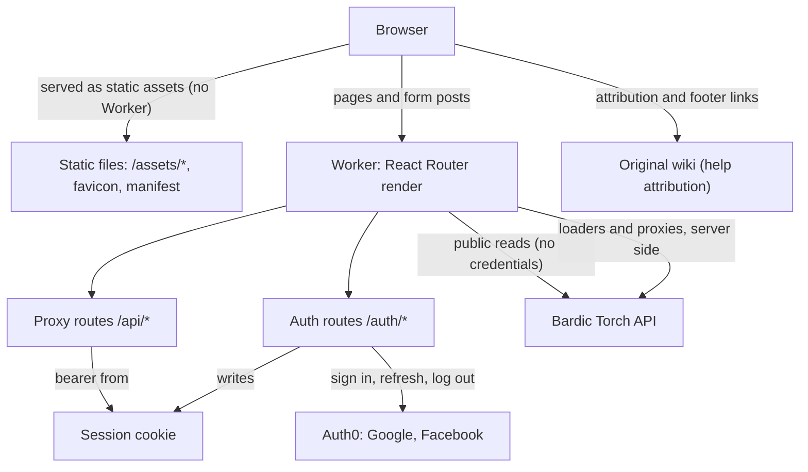

# Bardic Torch (frontend)

Bardic Torch is a community index of SCA bardic songs, stories and poems, and of the bards who made them, so they can be found, sung and passed on. It is an index, not an archive: every piece points to where its lyrics, recordings or video already live. **Links only, never lyrics.** It replaces the original wiki at https://bardictorch.miraheze.org, whose prose stays CC BY-SA 4.0.

This repository is the web frontend at https://bardictorch.org. It is a React Router 8 app in framework mode (React 19, Vite 8, Tailwind 4, TypeScript 6) on Cloudflare Workers, with the static files served as Workers static assets. The API lives in a separate backend repository and is served at https://api.bardictorch.org.

This is milestone FE2, the read UI, on top of FE1's foundation. FE1 gave it:

- the wiki-style layout, with a header, sidebar, mobile bottom app bar and footer;
- the design system, in light and dark;
- Auth0 sign-in with Google or Facebook;
- the settings page, for your display name;
- the static help pages.

FE2 adds the catalogue, read-only and anonymous:

- the home page, with the catalogue's size and its ways in;
- the piece browse and A–Z (`/pieces`), with facets, text search and paging, and search results (`/search`);
- a page for each piece, bard (any person or group), category, collection and event or venue, with its Read and History views, and a page for each revision with its changes (`/revisions/:id`);
- the directories (`/bards`, `/categories`, `/collections`, `/events`);
- `robots.txt` and one `sitemap.xml`, and page metadata for search engines (indexed in the production build only).

Signed-in readers can edit: an editor for each kind of page (`/pieces/:slug/edit`, `/pieces/new`, and the same for bards, categories, collections and events) and their own revisions (`/contributions`), where a pending edit can be continued or withdrawn.

FE4 adds moderation and contact. Anyone can write to the moderators through the contact form (`/contact`, with Cloudflare Turnstile; reporting a link is the same form), and see the pages that need work (`/needs-work`). Moderators get the queue (`/moderation`), each edit's review with its diffs and the stale warning (`/moderation/revisions/:id`, approve or reject with a note), the contact inbox (`/moderation/contact`), takedown of a link (`/moderation/links`) and blocking (`/moderation/users`). Those pages call moderation operations, which the API refuses to anyone else: its answer is the gate. The original wiki is linked only for the help pages' attribution, the footer and the 404 page.

## Key concepts

- **Contract-first API.** `api/openapi.yaml` is the backend's OpenAPI 3.1 spec, vendored byte for byte with `npm run sync:api -- <path|url>`. Nobody edits it here.
  - `app/api/schema.gen.ts` is generated from it (`npm run gen:api`); `check:api` fails if that file is stale.
  - Response bodies are typed from the generated types and not validated at runtime; zod validates input only (forms, config).
- **Catalogue reads are anonymous.** The catalogue's pages call the API's public `GET /v1/...` operations from loaders in `app/server/catalogue.server.ts`, with no credentials, whether or not you are signed in. Each failure is mapped to our own page (`app/catalogue/read-failure.ts`): a 404 is the not-found page, and anything else (an outage, a 5xx, a timeout, an unreadable answer) is the "resting" page (503 with `Retry-After`). Pages are not cached upstream in FE2.
- **URLs are the state.** A list's search, filters, letter and page are query parameters, parsed and written canonically by `app/catalogue/query-state.ts`: a non-canonical address gets one 301, and the filter forms are plain GET forms, so they work without JavaScript.
- **Restricted pieces.** A piece whose creator asks that it isn't shared further never shows its links outside one closed disclosure, and is kept out of the sitemap (`app/server/sitemap.server.ts`) and search engines (`noindex, nofollow`, in the piece route's `meta`). The site's own lists and search still show it, with a Restricted badge and no links (`app/catalogue/restricted.ts`).
- **Indexing.** Only the production build can be indexed: `__INDEXABLE__` is true in it alone, and the preview, e2e and development builds answer `Disallow: /` and send `X-Robots-Tag: noindex` on every response the Worker makes (static assets get the `Disallow` only). `/robots.txt`, and one `/sitemap.xml` are resource routes.
- **The browser never calls the API.** Loaders and actions call it from the Worker through `app/server/api.server.ts`. Writes are form posts: the editors, Withdraw, the moderation pages and the contact form are document POSTs to their own route's action (they work without JavaScript, apart from the contact form's Turnstile check), and settings use the proxy route `PATCH /api/me`. Each checks same-origin.
  - The access token lives in the server-side session and is sent as `Authorization: Bearer <jwt>`.
  - The proxies and the editors' actions accept form-encoded bodies, check same-origin (CSRF), validate the input, and map every API error code to the app's own wording.
- **Sessions.** Sign-in is an OpenID Connect authorization-code flow with PKCE (openid-client, configured statically for the Auth0 tenant). The app keeps only the Auth0 tokens in a signed cookie session, `__Host-bt_session` (HttpOnly, Secure, SameSite=Lax), and refreshes the access token before it expires, once per request.
  - Each sign-in's state and PKCE verifier wait for `/auth/callback` in their own signed cookie, `__Host-bt_auth0:<state>`, for 5 minutes. The callback checks the state's format and that it matches the cookie, then clears the cookie.
  - `/auth/login` remembers where to come back to in `__Host-bt_return_to`. `/auth/callback` validates it again with `safeReturnTo`.
  - Log out is a POST to `/auth/logout`, which then goes to Auth0's logout.
- **Build modes.**

  | mode          | command                 | stub sign-in |
  | ------------- | ----------------------- | ------------ |
  | `production`  | `npm run build`         | never        |
  | `preview`     | `npm run build:preview` | never        |
  | `e2e`         | `npm run build:e2e`     | compiled in  |
  | `development` | `npm run dev`           | compiled in  |

  Each build command runs `node scripts/build.mjs <mode>`, whose Vite mode decides stub sign-in. Workers Builds runs `npm run build:ci`, which picks the mode from `WORKERS_CI_BRANCH`: `production` on `main`, and `preview` on the `preview` branch; any other branch fails the build, and an empty branch fails too (docs/DEPLOY.md §2). A `production` build deploys to the `bardic-torch-fe` Worker, a `preview` build to `bardic-torch-fe-preview` (both in `wrangler.jsonc`). `check:prod-build` proves that production and preview builds contain no stub code.

- **Fixture API.** `test/fixture-api/` serves canned answers to the catalogue's reads, to `getMe`/`updateMe` for a few invented users, and to the editing, moderation and contact operations. The same router drives the msw handlers in unit tests, the HTTP server in e2e, and `npm run dev:fixtures`. Every fixture response is checked against the spec.
- **Design tokens.** All colour comes from `app/styles/tokens.ts`.
  - `app/styles/tokens.css` is hand-written; a test keeps its colours in step with `tokens.ts`.
  - Tailwind's palette is replaced by the tokens, so there are no `dark:` classes and no raw colours.
  - The theme (light, dark or system) is a `theme` cookie that the server renders, so the page never flashes.
- **Security headers.** Every document carries a per-request nonce CSP and the other security headers, set in `app/entry.server.tsx`; `app/server/worker.server.ts` adds the static ones to every other response the Worker makes. `public/_headers` only sets caching for `/assets/*`.

Design: [docs/DESIGN.md](docs/DESIGN.md) · Tests: [docs/TESTING.md](docs/TESTING.md) · Deploying: [docs/DEPLOY.md](docs/DEPLOY.md) · Working rules: [CLAUDE.md](CLAUDE.md)

## How a request flows



## Getting started

You need Node 26.13.0 (see `.nvmrc`) and npm 12.2.1 or later.

```sh
npm ci
npm run dev:fixtures   # fixture API + dev server (the Worker in workerd) with stub sign-in
```

Then open http://localhost:5173/auth/login?as=contributor. You are signed in as a fixture user and can use `/settings` with no Auth0 or API at all.

To run against a real Auth0 tenant and the API, copy `.dev.vars.example` to `.dev.vars`, fill it in, then run `npm run dev`. Use a separate Auth0 development application whose Allowed Callback URLs include `http://localhost:5173/auth/callback` and whose Allowed Logout URLs include `http://localhost:5173` (docs/DEPLOY.md §4, Local development); the production application doesn't list `localhost`.

To try a build as Cloudflare runs it, run `npm run build` (or `build:preview`), then `npm run serve`: `wrangler dev` serves that build's Worker and static files in workerd, on http://localhost:8787. It reads the production (or preview) `vars` from the build, with your `.dev.vars` laid over them, so fill in `.dev.vars` first (until then every page is the "Site configuration error" page). Requests keep their local origin (`--infer-origin-from-routes=false`), not the production host wrangler would infer from `routes`, so the same-origin checks accept local form posts. To sign in, set `AUTH0_DEFAULT_REDIRECT_URI=http://localhost:8787` in `.dev.vars` and add `http://localhost:8787/auth/callback` and `http://localhost:8787` to the Auth0 development application's callback and logout URLs.

## Checks

| command                    | what it runs                                                                                                        |
| -------------------------- | ------------------------------------------------------------------------------------------------------------------- |
| `npm run validate`         | check:types, gen:types, format:check, lint, tsc, check:unused, check:api, every vitest test, check:prod-build       |
| `npm run test:e2e`         | Playwright: the journeys and the per-template axe and reflow checks; needs Chromium                                 |
| `npm run screenshots`      | Playwright: on-demand screenshots of every template, light and dark, at 360 and 1280; needs Chromium                |
| `npm run audit`            | `npm audit`: any runtime advisory (info included), or a high or critical one anywhere; needs the registry           |
| `npm run audit:signatures` | `npm audit signatures`: the installed packages' registry signatures and provenance; needs the registry and Sigstore |

CI runs the first two as the `validate` and `e2e` jobs (`.github/workflows/ci.yml`), and both audits as the `audit` job (`.github/workflows/audit.yml`, weekly and on pull requests to `main`): all three are required checks on `main`. [docs/TESTING.md](docs/TESTING.md) explains the layers.

`package.json` has one override, `"typescript": "$typescript"`: it gives TypeScript 6 to `openapi-typescript`, whose peer range (`^5.x`) still stops at 5. A hygiene test keeps it the only one.

**Versions held back.** Every dependency is pinned to npm's `latest`, except:

- `@playwright/test` and `playwright-core` stay at **1.61.1**, the version of the Playwright browser image the e2e gate runs in (CLAUDE.md, "Running e2e"). Move them with the image.
- `typescript` stays at **6.0.3**. TypeScript 7 has no compiler API yet (it is planned for 7.1), while typescript-eslint (its peer range stops below 6.1) and `openapi-typescript` (`npm run gen:api`) need it.
- `wrangler` stays at the version `@cloudflare/vite-plugin` pins exactly, so there is one wrangler and one workerd. Move it with the plugin, and the compatibility date with it (docs/DEPLOY.md §2, "Runtime").

## Licence

The code is MIT ([LICENSE](LICENSE)). The help pages are adapted from the original wiki and are CC BY-SA 4.0, credited to its contributors; see `/help/licence`.
